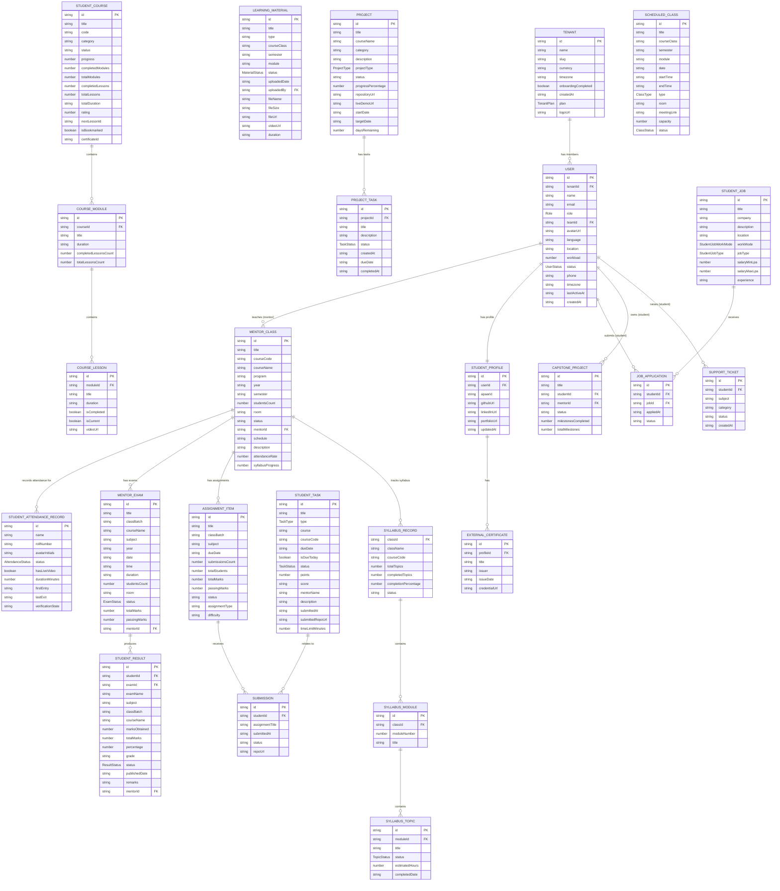

# LMS Database Entities

This document describes all data entities identified in the LeadFlow LMS frontend, including their field definitions, relationships, and example JSON structures. Entities are derived strictly from TypeScript types, interfaces, and mock data found in the codebase.

---

## Entity Relationship Diagram (Mermaid ERD)



---

## Entity Definitions

### 1. User

**Source:** `src/types/auth.ts`

```json
{
  "id": "usr-001",
  "tenantId": "ten-001",
  "name": "Hasna PK",
  "email": "hasna@leadflow.test",
  "role": "mentor",
  "teamId": null,
  "avatarUrl": "https://example.com/avatar.jpg",
  "language": "en",
  "location": "Calicut",
  "workload": 128,
  "status": "active",
  "phone": "+91-9876543210",
  "timezone": "Asia/Kolkata",
  "lastActiveAt": "2026-11-06T09:00:00Z",
  "createdAt": "2026-01-01T00:00:00Z"
}
```

**Roles:** `'super_admin' | 'admin' | 'manager' | 'team_leader' | 'salesperson' | 'mentor' | 'student'`
**Statuses:** `'active' | 'invited' | 'inactive'`

---

### 2. Tenant (Workspace)

**Source:** `src/types/auth.ts`

```json
{
  "id": "ten-001",
  "name": "LeadFlow Tech Academy",
  "slug": "leadflow-tech",
  "currency": "INR",
  "timezone": "Asia/Kolkata",
  "onboardingCompleted": true,
  "createdAt": "2026-01-01T00:00:00Z",
  "plan": "pro",
  "logoUrl": null
}
```

**Plans:** `'free' | 'pro' | 'enterprise'`

---

### 3. SessionUser

**Source:** `src/types/auth.ts`

Subset of User used in the JWT session token / auth store.

```json
{
  "id": "usr-001",
  "tenantId": "ten-001",
  "name": "Hasna PK",
  "email": "hasna@leadflow.test",
  "role": "mentor",
  "teamId": null,
  "avatarUrl": "https://example.com/avatar.jpg"
}
```

---

### 4. MentorClass

**Source:** `src/mentor-features/my-classes/types.ts`

```json
{
  "id": "cls-101",
  "title": "Data Structures & Algorithms",
  "courseCode": "DSA-301",
  "courseName": "Computer Science Core",
  "program": "BCA",
  "year": "3rd Year",
  "semester": "Semester 3",
  "studentsCount": 42,
  "room": "Room 302",
  "status": "active",
  "iconType": "code",
  "mentorId": "usr-mentor-01",
  "schedule": "Mon, Wed, Fri — 09:00 AM to 10:00 AM",
  "description": "Comprehensive study of data structures and algorithm complexity.",
  "attendanceRate": 92,
  "syllabusProgress": 65,
  "enrolledStudents": [
    {
      "id": "std-001",
      "name": "Ahmed Khan",
      "rollNumber": "BCA23001",
      "email": "ahmed@student.test",
      "attendancePercentage": 88,
      "statusToday": "present"
    }
  ]
}
```

---

### 5. MentorExam

**Source:** `src/mentor-features/exams/types.ts`

```json
{
  "id": "exam-001",
  "title": "Mid-Term Theory Examination",
  "classBatch": "BCA - 3rd Year",
  "courseName": "Computer Science Core",
  "subject": "Data Structures & Algorithms",
  "year": "2026-27",
  "date": "2026-10-18",
  "formattedDate": "18 Oct 2026",
  "time": "02:00 PM",
  "duration": "3 Hours",
  "studentsCount": 42,
  "room": "Hall A",
  "status": "upcoming",
  "totalMarks": 100,
  "passingMarks": 40,
  "instructions": "All electronic devices must be switched off.",
  "mentorId": "usr-mentor-01",
  "studentGrades": [
    {
      "id": "grade-001",
      "name": "Ahmed Khan",
      "rollNumber": "BCA23001",
      "email": "ahmed@student.test",
      "marksObtained": 87,
      "totalMarks": 100,
      "grade": "A",
      "status": "graded"
    }
  ]
}
```

---

### 6. StudentResult

**Source:** `src/mentor-features/results/types.ts`

```json
{
  "id": "res-001",
  "studentId": "BCA23001",
  "studentName": "Ahmed Khan",
  "studentEmail": "ahmed@student.test",
  "examId": "exam-001",
  "examName": "Mid-Term Theory Examination",
  "subject": "Data Structures & Algorithms",
  "classBatch": "BCA - 3rd Year",
  "courseName": "Computer Science Core",
  "marksObtained": 87,
  "totalMarks": 100,
  "percentage": 87,
  "grade": "A",
  "status": "published",
  "publishedDate": "2026-10-20",
  "remarks": "Excellent performance in tree traversal problems.",
  "mentorId": "usr-mentor-01"
}
```

---

### 7. AssignmentItem (Mentor-side)

**Source:** `src/mentor-features/assignments/mockData.ts`

```json
{
  "id": "asg-1",
  "title": "React Custom Hooks & State Management Lab",
  "classBatch": "BCA - 3rd Year",
  "subject": "Web Development & React",
  "dueDate": "10 Oct 2026",
  "startDate": "05 Oct 2026",
  "submissionsCount": 18,
  "totalStudents": 24,
  "totalMarks": 50,
  "passingMarks": 20,
  "status": "active",
  "assignmentType": "Lab Assignment",
  "difficulty": "Medium",
  "submissionType": "GitHub Repository",
  "description": "Implement a reusable custom hook for attendance tracking."
}
```

---

### 8. StudentTask (Student-side)

**Source:** `src/student-features/assignments/data/assignmentsData.ts`

```json
{
  "id": "assign-1",
  "title": "React Custom Hooks & Attendance Tracker Lab",
  "type": "assignment",
  "course": "Full-Stack Web Development",
  "courseCode": "FS-2026",
  "dueDate": "Today, 11:59 PM",
  "isDueToday": true,
  "isOverdue": false,
  "status": "pending",
  "points": 100,
  "mentorName": "Hasna PK",
  "mentorAvatar": "https://...",
  "description": "Implement a reusable custom hook...",
  "instructions": [
    "Create a hook `useAttendanceCalculator(weeklyData)`...",
    "Ensure strict TypeScript typing..."
  ],
  "submittedAt": null,
  "submittedRepoUrl": null,
  "submittedNotes": null,
  "feedbackNotes": null,
  "timeLimitMinutes": null,
  "questions": null
}
```

**Quiz variant:**
```json
{
  "id": "quiz-1",
  "title": "TypeScript Generics & Zod Validation Challenge",
  "type": "quiz",
  "timeLimitMinutes": 15,
  "questions": [
    {
      "id": "q1",
      "question": "Which keyword constrains a generic type?",
      "options": ["implements", "extends", "instanceof", "keyof"],
      "correctOptionIndex": 1,
      "explanation": "The `extends` keyword constrains generic type parameters."
    }
  ]
}
```

---

### 9. LearningMaterial

**Source:** `src/mentor-features/materials/types.ts`

```json
{
  "id": "mat-001",
  "title": "React Hooks Deep Dive Notes",
  "description": "Comprehensive notes on useState, useEffect, useRef, and custom hooks.",
  "type": "pdf",
  "courseClass": "BCA 3rd Year - Batch A",
  "semester": "Semester 5",
  "module": "Module 1",
  "topic": "React Hooks",
  "status": "published",
  "uploadedDate": "2026-10-01",
  "uploadedBy": "usr-mentor-01",
  "fileName": "react_hooks_notes.pdf",
  "fileSize": "2.4 MB",
  "fileUrl": "https://storage.example.com/materials/react_hooks.pdf"
}
```

**Video variant:**
```json
{
  "id": "mat-002",
  "title": "React useState & useEffect Video Lecture",
  "type": "video",
  "courseClass": "BCA 3rd Year - Batch A",
  "semester": "Semester 5",
  "module": "Module 1",
  "status": "published",
  "uploadedDate": "2026-10-02",
  "uploadedBy": "usr-mentor-01",
  "videoSource": "url",
  "videoUrl": "https://youtube.com/embed/abc123",
  "duration": "45m"
}
```

---

### 10. StudentCourse

**Source:** `src/student-features/courses/data/coursesData.ts`

```json
{
  "id": "course-fullstack-101",
  "title": "Full-Stack Web & AI Application Development",
  "code": "FS-2026",
  "category": "Full-Stack",
  "status": "in_progress",
  "progress": 78,
  "completedModules": 14,
  "totalModules": 18,
  "completedLessons": 42,
  "totalLessons": 54,
  "totalDuration": "48h 30m",
  "rating": 4.9,
  "nextLessonId": "class-1",
  "nextLessonTitle": "Building Realtime AI Chat Agents",
  "instructor": {
    "name": "Hasna PK",
    "role": "Senior Full-Stack Mentor",
    "avatar": "https://images.unsplash.com/..."
  },
  "thumbnail": "https://images.unsplash.com/...",
  "isBookmarked": true,
  "isLiveClassActive": true,
  "liveClassTime": "Today at 05:00 PM",
  "lastAccessed": "2 hours ago",
  "description": "Master modern React 19, TypeScript...",
  "modules": [
    {
      "id": "mod-1",
      "title": "Module 1: Modern React 19 & Core Hooks",
      "duration": "6h 15m",
      "completedLessonsCount": 4,
      "totalLessonsCount": 4,
      "lessons": [
        {
          "id": "les-1-1",
          "title": "React 19 Compiler & Actions Overview",
          "duration": "45m",
          "isCompleted": true,
          "isCurrent": false,
          "videoUrl": null,
          "content": []
        }
      ]
    }
  ]
}
```

---

### 11. LessonContentBlock

**Source:** `src/student-features/courses/data/coursesData.ts`

Union type for rich lesson content:

```json
{ "id": "blk-1", "type": "text", "title": "Hook Overview", "body": "..." }
{ "id": "blk-2", "type": "video", "title": "Lecture Recording", "url": "https://...", "caption": "Recorded class" }
{ "id": "blk-3", "type": "image", "title": "React Lifecycle", "url": "https://...", "alt": "Lifecycle diagram", "caption": "State vs Props" }
{ "id": "blk-4", "type": "external-link", "title": "MDN Docs", "url": "https://developer.mozilla.org", "description": "Official reference" }
{ "id": "blk-5", "type": "live-class", "title": "Live Q&A Session", "scheduledAt": "2026-10-20 05:00 PM", "joinUrl": "https://meet.google.com/abc" }
{ "id": "blk-6", "type": "code", "title": "useState Example", "code": "const [count, setCount] = useState(0)", "language": "typescript" }
{ "id": "blk-7", "type": "download", "title": "Lecture Notes PDF", "url": "https://...", "description": "Download for offline study" }
{ "id": "blk-8", "type": "assignment", "taskId": "assign-1" }
{ "id": "blk-9", "type": "quiz", "taskId": "quiz-1" }
```

---

### 12. Project

**Source:** `src/student-features/project/types/project.types.ts`

```json
{
  "id": "proj-001",
  "title": "LeadFlow CRM Dashboard",
  "subtitle": "A full-stack CRM analytics platform",
  "courseName": "Full-Stack Web Development",
  "category": "Web Application",
  "description": "Building a complete CRM platform with React 19 and Node.js.",
  "projectType": "group",
  "status": "in_progress",
  "progressPercentage": 65,
  "repositoryUrl": "https://github.com/team/leadflow",
  "liveDemoUrl": "https://leadflow-demo.vercel.app",
  "mentor": {
    "id": "usr-mentor-01",
    "name": "Hasna PK",
    "role": "Senior Full-Stack Mentor",
    "avatar": "https://..."
  },
  "team": {
    "id": "team-001",
    "name": "Team Alpha",
    "description": "Full-stack development team",
    "members": [
      {
        "id": "std-001",
        "name": "Ahmed Khan",
        "role": "team_lead",
        "progress": 70,
        "completedMilestones": 3,
        "totalMilestones": 5,
        "status": "on_track",
        "isCurrentUser": true,
        "studentId": "BCA23001"
      }
    ]
  },
  "startDate": "2026-09-01",
  "targetDate": "2026-12-31",
  "daysRemaining": 56,
  "techStack": ["React", "TypeScript", "Node.js", "PostgreSQL"],
  "tasks": [
    {
      "id": "task-001",
      "title": "Implement authentication flow",
      "description": "JWT login and role-based routing",
      "status": "completed",
      "createdAt": "2026-09-05",
      "createdBy": { "name": "Ahmed Khan", "role": "team_lead" },
      "assignee": { "id": "std-001", "name": "Ahmed Khan" },
      "dueDate": "2026-09-15",
      "completedAt": "2026-09-14"
    }
  ],
  "milestones": [
    {
      "id": "ms-001",
      "milestoneNumber": 1,
      "title": "Project Proposal",
      "description": "Submit the initial project proposal document.",
      "dueDate": "2026-09-10",
      "status": "completed",
      "completedDate": "2026-09-09",
      "deliverableFormat": "PDF Document",
      "instructions": "Include project scope, tech stack and timeline.",
      "rubricCriteria": ["Clarity of objective", "Feasibility analysis"],
      "totalPoints": 20,
      "earnedPoints": 18
    }
  ],
  "submissions": [
    {
      "id": "sub-001",
      "milestoneId": "ms-001",
      "milestoneTitle": "Project Proposal",
      "submittedAt": "2026-09-09T14:00:00Z",
      "submittedBy": "Ahmed Khan",
      "status": "approved",
      "repositoryLink": "https://github.com/team/leadflow",
      "demoLink": "https://leadflow-demo.vercel.app",
      "notes": "All rubric criteria met.",
      "grade": "A",
      "feedbackSummary": "Excellent proposal with clear objectives."
    }
  ],
  "comments": [
    {
      "id": "cmt-001",
      "userName": "Hasna PK",
      "userRole": "mentor",
      "date": "2026-09-10",
      "text": "Great start! Keep up the momentum.",
      "statusTag": "praise",
      "rating": 5
    }
  ],
  "mentorComments": []
}
```

---

### 13. StudentProfile

**Source:** `src/services/api/student-profile.ts`

```json
{
  "id": "profile-001",
  "userId": "usr-001",
  "tenantId": "ten-001",
  "apaarId": "APAAR-12345678",
  "careerLinks": {
    "github": "https://github.com/student",
    "linkedIn": "https://linkedin.com/in/student",
    "portfolio": "https://student.dev"
  },
  "externalCertificates": [
    {
      "id": "xcert-001",
      "title": "AWS Cloud Practitioner",
      "issuer": "Amazon Web Services",
      "issueDate": "2026-08-15",
      "credentialUrl": "https://aws.amazon.com/verify/cert-id"
    }
  ],
  "updatedAt": "2026-11-01T10:00:00Z",
  "account": {
    "name": "Ahmed Khan",
    "email": "ahmed@student.test",
    "phone": "+91-9876543210",
    "avatarUrl": "https://example.com/avatar.jpg"
  }
}
```

---

### 14. StudentJob

**Source:** `src/services/api/student-jobs.ts`

```json
{
  "id": "job-001",
  "title": "React Developer Intern",
  "company": "TechCorp Solutions",
  "description": "Build and maintain React applications...",
  "location": "Bangalore, India",
  "workMode": "hybrid",
  "jobType": "internship",
  "salaryMinLpa": 3,
  "salaryMaxLpa": 6,
  "experience": "0–1 years",
  "skills": ["React", "TypeScript", "Tailwind CSS"],
  "source": "LMS job portal (demo)"
}
```

---

### 15. ScheduledClass

**Source:** `src/mentor-features/schedule/types.ts`

```json
{
  "id": "sched-001",
  "title": "React Hooks Lab Session",
  "courseClass": "BCA 3rd Year - Batch A",
  "semester": "Semester 5",
  "module": "Module 1: React Fundamentals",
  "date": "2026-11-08",
  "startTime": "09:00 AM",
  "endTime": "10:00 AM",
  "duration": "1 hour",
  "type": "in-person",
  "room": "Room 302",
  "meetingPlatform": null,
  "meetingLink": null,
  "description": "Hands-on lab for useState and custom hooks",
  "attachedMaterialTitles": ["React Hooks Notes"],
  "capacity": 42,
  "attendanceRequired": true,
  "allowRecording": false,
  "notifyStudents": true,
  "status": "scheduled"
}
```

---

### 16. SyllabusRecord (ClassSyllabusRecord)

**Source:** `src/mentor-features/syllabus-completion/types.ts`

```json
{
  "classId": "cls-101",
  "className": "Data Structures & Algorithms",
  "courseCode": "DSA-301",
  "program": "BCA",
  "year": "3rd Year",
  "semester": "Semester 3",
  "totalTopics": 48,
  "completedTopics": 31,
  "inProgressTopics": 4,
  "notStartedTopics": 13,
  "totalModules": 8,
  "completedModules": 5,
  "inProgressModules": 1,
  "notStartedModules": 2,
  "completionPercentage": 65,
  "status": "On Track",
  "phaseText": "Mid-semester — 65% complete",
  "modules": [
    {
      "id": "syl-mod-1",
      "moduleNumber": 1,
      "title": "Arrays & Linked Lists",
      "description": "Fundamentals of linear data structures",
      "topics": [
        {
          "id": "topic-1",
          "title": "Array indexing & traversal",
          "status": "completed",
          "estimatedHours": 2,
          "completedDate": "2026-09-15",
          "notes": "Covered with live coding demos"
        }
      ]
    }
  ]
}
```

---

### 17. SupportTicket

**Source:** `src/mentor-features/helpdesk-resource-hub/types.ts`

```json
{
  "id": "ticket-001",
  "studentId": "std-001",
  "subject": "Cannot access Module 5 video lessons",
  "category": "Course Access",
  "status": "open",
  "createdAt": "2026-11-05T09:30:00Z"
}
```

---

### 18. Submission (Code Review)

**Source:** `src/mentor-features/student-submissions-code-reviews/types.ts`

```json
{
  "id": "sub-code-001",
  "studentId": "std-001",
  "assignmentTitle": "React Custom Hooks & Attendance Tracker Lab",
  "submittedAt": "2026-10-09T16:30:00Z",
  "status": "pending",
  "repoUrl": "https://github.com/student/hooks-lab"
}
```

---

### 19. CapstoneProject (Mentor-facing minimal entity)

**Source:** `src/mentor-features/capstone-projects/types.ts`

```json
{
  "id": "cap-001",
  "title": "E-Commerce Platform with AI Recommendations",
  "studentId": "std-001",
  "mentorId": "usr-mentor-01",
  "status": "in-progress",
  "milestonesCompleted": 2,
  "totalMilestones": 5
}
```

---

### 20. Dashboard KPI Data (Mentor)

**Source:** `src/mentor-features/dashboard/types.ts`

```json
{
  "mentorKpi": {
    "totalClasses": 5,
    "totalStudents": 186,
    "avgAttendance": 91,
    "pendingReviews": 12,
    "activeStudents": 180,
    "attendanceRate": 92,
    "avgCodeScore": 78,
    "activeCapstones": 8,
    "scheduledSessions": 3,
    "openTickets": 4
  },
  "todaySchedule": [...],
  "recentClasses": [...],
  "announcements": [...]
}
```

---

## Summary Table of Entities

| Entity | Source Location | API-Connected? | Backend Table Needed |
|---|---|---|---|
| User | `types/auth.ts` | Yes (mock) | `users` |
| Tenant | `types/auth.ts` | Yes (mock) | `tenants` |
| MentorClass | `mentor-features/my-classes/types.ts` | No (mock) | `classes` |
| StudentRosterItem | Embedded in MentorClass | No (mock) | via `enrollments` |
| MentorExam | `mentor-features/exams/types.ts` | No (mock) | `exams` |
| StudentGradeItem | Embedded in MentorExam | No (mock) | `grades` |
| StudentResult | `mentor-features/results/types.ts` | No (mock) | `results` |
| AssignmentItem | `mentor-features/assignments/mockData.ts` | No (mock) | `assignments` |
| StudentTask | `student-features/assignments/data/assignmentsData.ts` | No (mock) | `assignments` |
| QuizQuestion | Embedded in StudentTask | No (mock) | `quiz_questions` |
| LearningMaterial | `mentor-features/materials/types.ts` | No (mock) | `materials` |
| StudentCourse | `student-features/courses/data/coursesData.ts` | No (mock) | `courses`, `enrollments` |
| CourseModule | Embedded in StudentCourse | No (mock) | `course_modules` |
| CourseLesson | Embedded in CourseModule | No (mock) | `lessons` |
| Project | `student-features/project/types/project.types.ts` | No (mock) | `projects` |
| ProjectTask | Embedded in Project | No (mock) | `project_tasks` |
| ProjectMilestone | Embedded in Project | No (mock) | `milestones` |
| StudentProfile | `services/api/student-profile.ts` | **Yes (real API client)** | `student_profiles` |
| ExternalCertificate | Embedded in StudentProfile | **Yes (real API client)** | `external_certificates` |
| StudentJob | `services/api/student-jobs.ts` | **Yes (real API client)** | `jobs` |
| JobApplication | Embedded in StudentJobsOverview | **Yes (real API client)** | `job_applications` |
| ScheduledClass | `mentor-features/schedule/types.ts` | No (mock) | `schedules` |
| SyllabusRecord | `mentor-features/syllabus-completion/types.ts` | No (mock) | `syllabus_completion` |
| SyllabusTopic | Embedded in SyllabusRecord | No (mock) | `syllabus_topics` |
| AttendanceRecord | `mentor-features/attendance-tracking/types.ts` | No (mock) | `attendance` |
| SupportTicket | `mentor-features/helpdesk-resource-hub/types.ts` | No (mock) | `support_tickets` |
| CapstoneProject | `mentor-features/capstone-projects/types.ts` | No (mock) | `capstone_projects` |
| Submission (code review) | `mentor-features/student-submissions-code-reviews/types.ts` | No (mock) | `submissions` |
